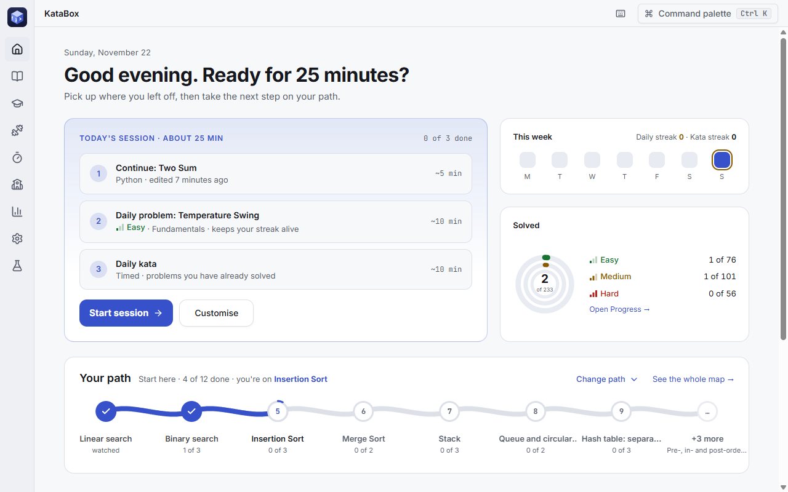
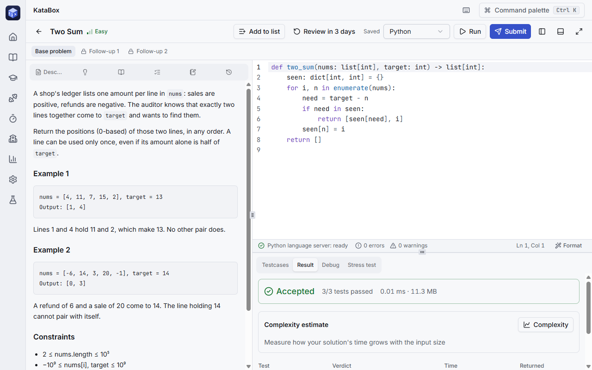
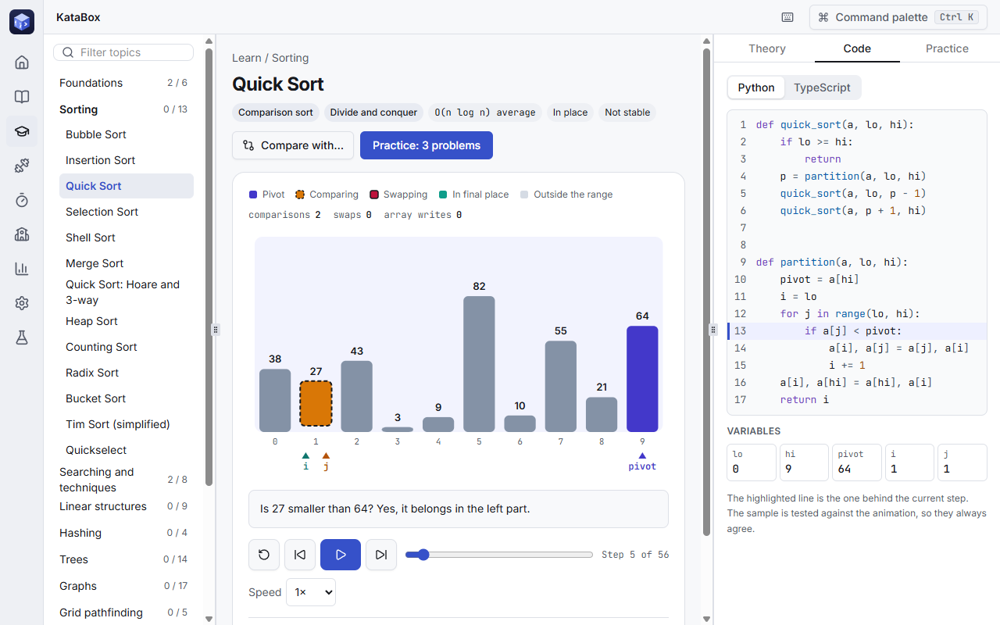

# KataBox


**Práctica de programación sin conexión, en tu escritorio.** KataBox es una aplicación gratuita y de código abierto para practicar problemas de programación, de fáciles a difíciles, en Python, JavaScript/TypeScript, PHP, Rust y SQL. Tu código se ejecuta en tu propio equipo, dentro de un sandbox, y se evalúa con pruebas públicas y ocultas. Sin cuenta, sin suscripción y sin internet una vez instalado un lenguaje.

[Read in English](README.md)

> **Estado:** 1.0.0-beta.2, solo para Windows. Las versiones para Linux todavía no están disponibles. [Descárgalo desde la página de Releases](https://github.com/kaspal/katabox/releases).

## Funciones

- **273 paquetes de problemas:** 233 problemas originales (174 problemas de función, 24 de ellos de "arregla el error", que empiezan con código con fallos; 35 problemas de programa con entrada y salida estándar; 24 problemas de SQL sobre SQLite) y 40 variantes de seguimiento más difíciles. 76 problemas fáciles, 101 medios y 56 difíciles, en 27 patrones.
- **Cinco lenguajes:** Python, JavaScript/TypeScript, PHP y Rust para los problemas de función y de programa; SQL para los problemas de SQL.
- **Pruebas:** ejemplos públicos, tus propias pruebas y pruebas ocultas que muestran la primera entrada que falla tras un envío fallido. En los problemas de función, un reductor encuentra una entrada más pequeña que sigue fallando.
- **Editor:** autocompletado y diagnósticos de servidores de lenguaje locales (Python, TypeScript, Rust).
- **Depurador y visualizador** para Python y TypeScript: avanza paso a paso por un caso de prueba y mira cómo cambian tus arreglos, cuadrículas, listas enlazadas, árboles, mapas y grafos.
- **Complejidad estimada** en 95 problemas: ejecuta tu solución con entradas cada vez más grandes y estima su complejidad temporal.
- **Ayuda cuando te atascas:** pistas en tres niveles y una explicación para cada problema.
- **Aprender:** 118 temas en 14 materias, con animaciones paso a paso, teoría, código de ejemplo y cuestionarios, además de 3 rutas de aprendizaje y 8 series de ejercicios de "leer el código".
- **Un Inicio que planifica tu sesión:** continúa tu borrador, el problema del día, una kata del día y el siguiente paso de tu ruta, con tiempos estimados; tu semana, tus resueltos y qué ver ahora.
- **Modos de práctica:** entrevistas simuladas con tiempo, repasos espaciados, problema del día, racha y listas personales; katas contra el reloj, una valoración por patrón, planes de estudio, un diario de errores, sesiones de concentración y una prueba de estrés contra tu propia fuerza bruta.
- **Progreso:** estadísticas, un mapa de actividad, el avance por dificultad y por tema, y el historial de tus envíos y de las versiones de tu código.
- **Paquetes de problemas y modo aula:** importa series `.kbpack` verificadas, crea las tuyas con el editor integrado y reparte tareas.
- **Exportar e importar** tu progreso en un solo archivo, y copias de seguridad automáticas en la carpeta que elijas.
- **Tres idiomas de interfaz:** inglés, español y portugués (Brasil).

## Capturas de pantalla








## Requisitos del sistema

- **Windows 10 u 11 de 64 bits (x64).**
- **WebView2.** Viene con Windows 10 y 11; el instalador lo agrega si falta.
- **Espacio en disco:** unos 75 MB para la aplicación, más cada lenguaje que instales:

  | Lenguaje | Descarga | En disco |
  | --- | --- | --- |
  | Python (también necesario para SQL) | 98 MB | 297 MB |
  | JavaScript/TypeScript | 46 MB | 140 MB |
  | PHP | 87 MB | 103 MB |
  | Rust | 244 MB | 959 MB |

  Python y JavaScript/TypeScript comparten Node.js (lo usan los servidores de lenguaje), así que instalar ambos ocupa menos que la suma.

Linux todavía no está disponible.

## Instalación

1. Descarga `KataBox_1.0.0-beta.2_x64-setup.exe` desde la página de [Releases](https://github.com/kaspal/katabox/releases).
2. Ejecútalo. Se instala solo para tu usuario; no hace falta ser administrador.
3. Esta beta no está firmada, así que Windows SmartScreen puede mostrar "Windows protegió su PC". Haz clic en **Más información** y luego en **Ejecutar de todas formas**.
4. Al iniciarse por primera vez, KataBox pregunta qué lenguajes instalar y los descarga. Después funciona sin conexión.

También hay un instalador `.msi` para equipos administrados (se instala para todo el equipo).

### Actualizar

Instala la nueva versión encima de la anterior. Se conservan tu progreso, tus borradores y tus ajustes.

### Desinstalar

Desinstala desde Configuración de Windows → Aplicaciones. Tus datos se conservan salvo que marques **Eliminar los datos de la aplicación** en el desinstalador. El `.msi` nunca borra tus datos.

## Dónde se guardan tus datos

| Qué | Dónde |
| --- | --- |
| Tu progreso, envíos, borradores, notas, ajustes, listas y repasos (`user.db`) | `%APPDATA%\dev.katabox.app` |
| El sandbox, los lenguajes instalados, las cachés y los archivos de proyecto de los servidores de lenguaje | `%LOCALAPPDATA%\dev.katabox.app` |

No se guarda nada en ningún otro lugar, salvo los archivos que exportes a la carpeta que elijas. Consulta [PRIVACY.md](PRIVACY.md).

## Sin conexión y privado

- KataBox funciona completamente sin conexión una vez instalado un lenguaje.
- Solo usa la red cuando instalas un lenguaje, para descargar los entornos de ejecución y los servidores de lenguaje. Cada archivo está fijado por URL, tamaño y SHA-256 y se comprueba antes de descomprimirlo, y las descargas van solo a una lista fija de servidores (GitHub, nodejs.org, windows.php.net, downloads.php.net, static.rust-lang.org, registry.npmjs.org).
- Sin telemetría, sin cuenta y sin búsqueda de actualizaciones.

## Documentación

- [Guía de uso](docs/user-guide.es.md)
- [Problemas conocidos](docs/known-issues.es.md)
- [Registro de cambios](CHANGELOG.md) (en inglés)
- [Privacidad](PRIVACY.md) (en inglés)
- [Seguridad](SECURITY.md) (en inglés)
- [Cómo contribuir](CONTRIBUTING.md) (en inglés)

## Compilar desde el código fuente

Requisitos: Rust (estable, ver `rust-toolchain.toml`), Node 22 o superior y pnpm 10.

```sh
pnpm install
pnpm dev          # ejecuta la aplicación
cargo test        # pruebas de Rust
pnpm test         # pruebas de la interfaz
```

Las versiones de desarrollo necesitan los lenguajes en una carpeta local: ejecuta antes `scripts/fetch-toolchains.ps1`. [CONTRIBUTING.md](CONTRIBUTING.md) tiene los detalles y las reglas para agregar problemas, traducciones y lenguajes.

## Licencia

- Código: [MIT](LICENSE-MIT) o [Apache-2.0](LICENSE-APACHE), a tu elección.
- Problemas y contenido de Aprender (`content/`): [CC BY-SA 4.0](https://creativecommons.org/licenses/by-sa/4.0/deed.es).
- Avisos de terceros: en la aplicación, en Ajustes → Acerca de → Avisos de terceros.
