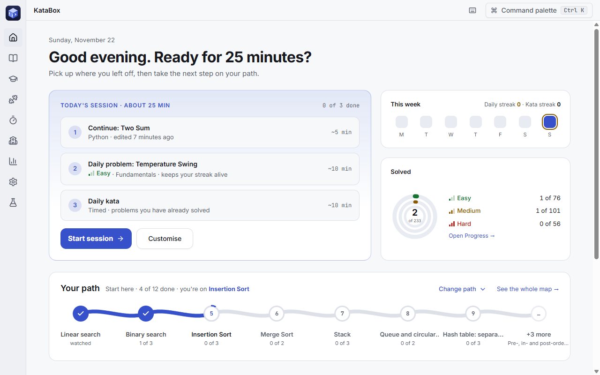
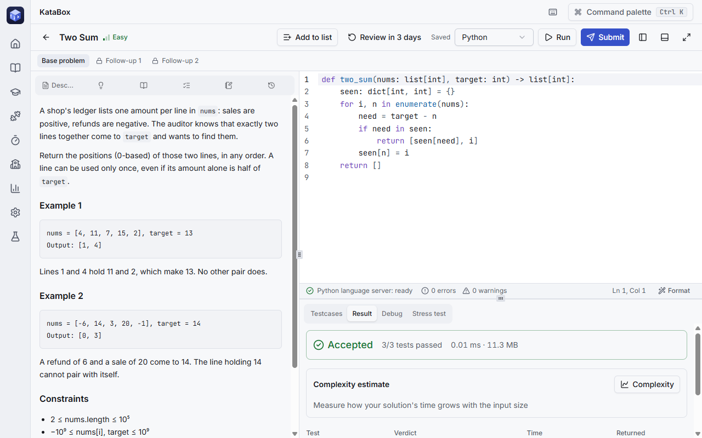
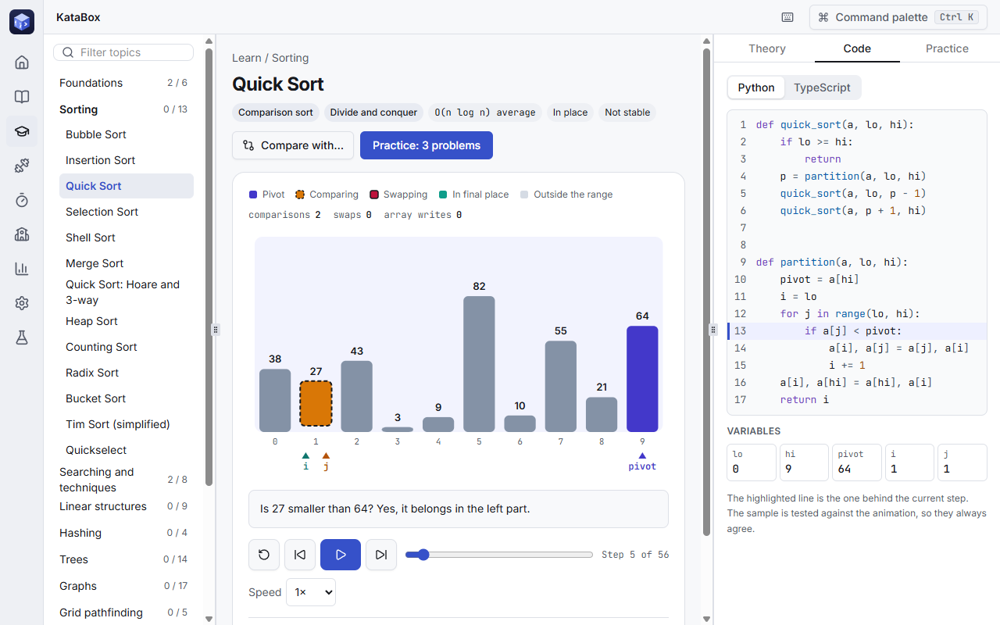
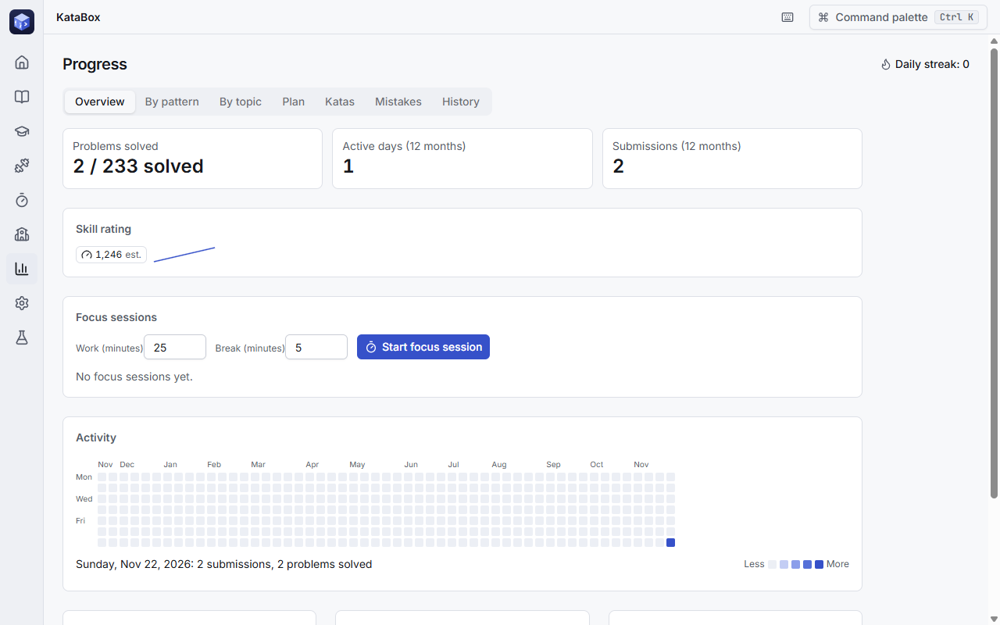

# KataBox


**Offline coding practice for your desktop.** KataBox is a free, open-source app for practising coding problems, from easy to hard, in Python, JavaScript/TypeScript, PHP, Rust and SQL. Your code runs on your own machine in a sandbox and is judged against public and hidden tests. No account, no subscription, and no internet needed once a language is installed.

[Leer en español](README.es.md)

> **Status:** 1.0.0-beta.2, Windows only. Linux builds are not available yet. [Download it from the Releases page](https://github.com/kaspal/katabox/releases).

## Features

- **273 problem packages:** 233 original problems (174 function problems, 24 of them "fix the bug" problems that start from buggy code; 35 program problems with stdin/stdout; 24 SQL problems on SQLite) and 40 harder follow-up variants. 76 easy, 101 medium and 56 hard problems across 27 patterns.
- **Five languages:** Python, JavaScript/TypeScript, PHP and Rust for function and program problems; SQL for SQL problems.
- **Tests:** public examples, your own custom tests, and hidden tests that show the first failing input after a failed submit. For function problems, a shrinker finds a smaller input that still fails.
- **Editor:** autocomplete and diagnostics from local language servers (Python, TypeScript, Rust).
- **Debugger and visualizer** for Python and TypeScript: step through a test case and see your arrays, grids, linked lists, trees, maps and graphs change.
- **Estimated complexity** for 95 problems: runs your solution on growing inputs and estimates its time complexity.
- **Help when you are stuck:** three tiers of hints and an editorial for every problem.
- **Learn:** 118 topics in 14 subjects, with step-by-step animations, theory, sample code and quizzes, plus 3 learning paths and 8 sets of "read the code" exercises.
- **A Home that plans your session:** continue your draft, the daily problem, a daily kata and the next step on your path, with time estimates; your week, your solved count and what to watch next.
- **Practice modes:** timed mock interviews, spaced reviews, a daily problem, a streak and personal lists; kata drills against the clock, a skill rating per pattern, study plans, a mistake journal, focus sessions and a stress test against your own brute force.
- **Progress:** stats, an activity heatmap, progress by difficulty and topic, and a history of your submissions and code snapshots.
- **Problem packs and classroom mode:** import verified `.kbpack` problem sets, make your own with the in-app editor, and hand out assignments.
- **Export and import** of your progress as a single file, and automatic backups to a folder you choose.
- **Three interface languages:** English, Spanish and Portuguese (Brazil).

## Screenshots









## System requirements

- **Windows 10 or 11, 64-bit (x64).**
- **WebView2.** It comes with Windows 10 and 11; the installer adds it if it is missing.
- **Disk space:** about 75 MB for the app, plus each language you install:

  | Language | Download | On disk |
  | --- | --- | --- |
  | Python (also needed for SQL) | 98 MB | 297 MB |
  | JavaScript/TypeScript | 46 MB | 140 MB |
  | PHP | 87 MB | 103 MB |
  | Rust | 244 MB | 959 MB |

  Python and JavaScript/TypeScript share Node.js (used by the language servers), so installing both takes less than the sum.

Linux is not available yet.

## Install

1. Download `KataBox_1.0.0-beta.2_x64-setup.exe` from the [Releases](https://github.com/kaspal/katabox/releases) page.
2. Run it. It installs for your user only; no administrator rights are needed.
3. This beta is not code-signed, so Windows SmartScreen may show "Windows protected your PC". Click **More info**, then **Run anyway**.
4. On first start, KataBox asks which languages to install and downloads them. After that it works offline.

An `.msi` installer is also available for managed machines (it installs per machine).

### Upgrading

Install the new version over the old one. Your progress, drafts and settings are kept.

### Uninstalling

Uninstall from Windows Settings → Apps. Your data is kept unless you tick **Delete the application data** in the uninstaller. The `.msi` never deletes your data.

## Where your data lives

| What | Where |
| --- | --- |
| Your progress, submissions, drafts, notes, settings, lists and reviews (`user.db`) | `%APPDATA%\dev.katabox.app` |
| The sandbox, installed languages, caches and language-server project files | `%LOCALAPPDATA%\dev.katabox.app` |

Nothing is stored anywhere else, except files you export to a folder you choose. See [PRIVACY.md](PRIVACY.md).

## Offline and private

- KataBox works fully offline once a language is installed.
- It uses the network only when you install a language, to download runtimes and language servers. Every file is pinned by URL, size and SHA-256 and checked before it is unpacked, and downloads go only to a fixed list of hosts (GitHub, nodejs.org, windows.php.net, downloads.php.net, static.rust-lang.org, registry.npmjs.org).
- No telemetry, no account, no update checks.

## Documentation

- [User guide](docs/user-guide.md)
- [Known issues](docs/known-issues.md)
- [Changelog](CHANGELOG.md)
- [Privacy](PRIVACY.md)
- [Security](SECURITY.md)
- [Contributing](CONTRIBUTING.md)

## Building from source

Requirements: Rust (stable, see `rust-toolchain.toml`), Node 22+ and pnpm 10.

```sh
pnpm install
pnpm dev          # run the app
cargo test        # Rust tests
pnpm test         # UI tests
```

Developer builds need languages in a local folder: run `scripts/fetch-toolchains.ps1` first. [CONTRIBUTING.md](CONTRIBUTING.md) has the details, and the rules for adding problems, translations and languages.

## License

- Code: [MIT](LICENSE-MIT) or [Apache-2.0](LICENSE-APACHE), at your option.
- Problems and Learn content (`content/`): [CC BY-SA 4.0](https://creativecommons.org/licenses/by-sa/4.0/).
- Third-party notices: in the app, under Settings → About → Third-party notices.
